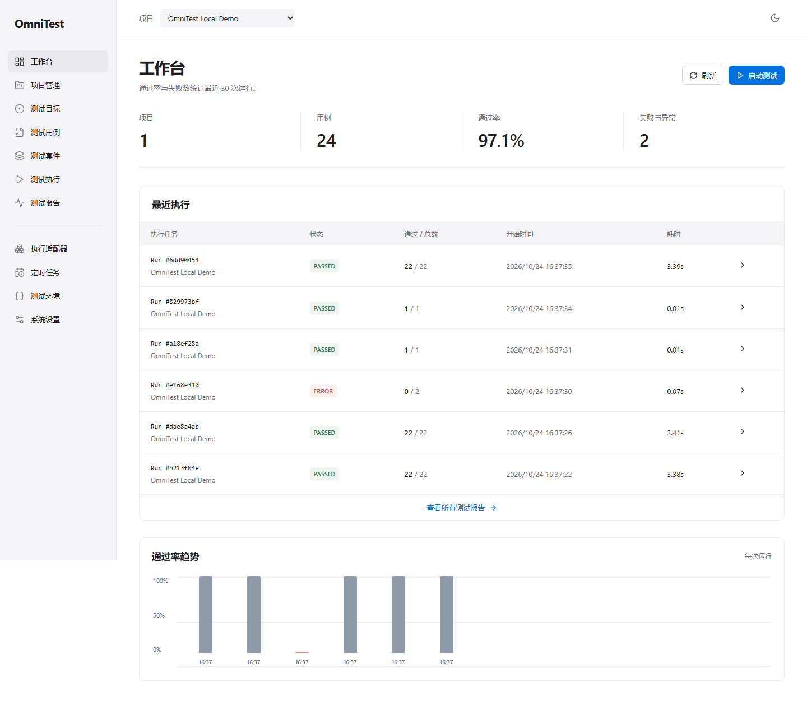

# OmniTest

**Automation First, AI Optional.** 面向多种软件、系统、协议和设备的通用自动化测试平台。

[](https://github.com/Sver0411/OmniTest/actions/workflows/ci.yml)
[](https://www.python.org/)
[](LICENSE)

Python 执行内核、FastAPI 管理 API、React 管理界面和独立 CLI。真实执行 HTTP、浏览器和受控本地程序测试；文件校验作为第四种领域，通过 Python entry point 接入。

本版本无需任何模型、API Key 或 AI 服务。示例数据只创建测试定义，所有运行记录、统计与证据均来自实际执行。

## 功能概览

- **通用测试内核**：可序列化 Test IR、统一任务生命周期、参数化与确定性断言。
- **可插拔执行器**：API、Web、受控 CLI，以及通过 Python entry point 加载的文件校验插件。
- **测试管理**：项目、授权目标、用例、套件、环境和持久化定时任务。
- **执行与报告**：并发限制、超时、重试、取消、历史记录、截图与文件证据、JSON / JUnit 导出。
- **多种使用入口**：Web 管理界面、CLI 和 REST API。
- **AI 可选**：自动化核心不依赖 AI；第一阶段只定义独立扩展接口。

**Phase 1 / v0.1.0** 已完成。当前开发增量加入 SQLite 只读数据库、TCP 和受限 HTTP 性能测试；第二阶段仍在推进，详见 [Phase 2 使用说明](docs/phase2.md)。未实现的能力不会在界面中伪装为可用功能。



## 环境与安装

- Python 3.12+，Node.js 22.12+（本次验证为 Python 3.12.15、Node 24.21.0）
- Windows / Linux / macOS；本次实际验证环境为 Windows，Linux 验证流程已配置到 CI，尚未在本机运行。
- 以下命令均从项目根目录执行。Playwright 必须安装 Chromium；仅安装 Python 包不足以运行 Web 测试。

Windows PowerShell：

```powershell
python -m venv .venv
.venv\Scripts\Activate.ps1
python -m pip install -r requirements-dev.lock
$env:PLAYWRIGHT_BROWSERS_PATH = "$PWD/data/browsers"
python -m playwright install chromium
npm --prefix frontend ci
npm --prefix frontend run build
omnitest init
```

Linux / macOS：

```bash
python3.12 -m venv .venv
source .venv/bin/activate
python -m pip install -r requirements-dev.lock
export PLAYWRIGHT_BROWSERS_PATH="$PWD/data/browsers"
python -m playwright install --with-deps chromium
npm --prefix frontend ci
npm --prefix frontend run build
omnitest init
```

`requirements-dev.lock` 固定本次验证的依赖版本，包含测试工具与 editable 项目安装。若只安装运行依赖，可使用 `pip install -e .`，但将按 `pyproject.toml` 的兼容范围解析版本。Python 包内部携带 Alembic 迁移；首次启动和 CLI 初始化均自动升级数据库。

## 本地启动与第一次运行

先启动独立的被测示例服务：

```bash
python -m uvicorn omnitest.demo_app:app --host 127.0.0.1 --port 8765
```

另一个已激活虚拟环境的终端，设置同一个 `PLAYWRIGHT_BROWSERS_PATH`，执行：

```bash
omnitest seed-demo --base-url http://127.0.0.1:8765
omnitest serve
```

打开 [管理界面](http://127.0.0.1:8000) 或 [OpenAPI 文档](http://127.0.0.1:8000/docs)。右上角选择 **OmniTest Local Demo**，在“测试执行”中运行 **Acceptance · all passing cases**。

示例包含 24 个用例定义：8 个 API、7 个 Web、6 个 CLI 正常用例，2 个故意产生 FAILED／ERROR 的诊断用例，以及 1 个文件插件用例。正常套件的参数化用例展开后为 **22 个执行结果**，诊断套件预期 1 FAILED + 1 ERROR，不属于正常套件。

`seed-demo` 按项目名称避免重复导入，不会修改已有项目的测试目标，也不会伪造历史结果。使用其他端口时，请编辑目标的 `base_url`，或选择新的数据目录。

开发前端：运行 `npm --prefix frontend run dev`，访问 Vite 输出的本地地址；`/api` 代理至 8000 端口，避免跨域配置。

## 无前端 CLI

```bash
omnitest list projects
omnitest list suites --project PROJECT_ID
omnitest run --project PROJECT_ID --suite SUITE_ID
omnitest run --project PROJECT_ID --case CASE_ID --environment ENVIRONMENT_ID
omnitest report RUN_ID --output report.json
```

本地 CLI 和服务使用相同数据目录。为防止两个调度器争抢任务，目录被运行中的服务锁定；服务已启动时，请通过 API 模式使用 CLI：

```bash
omnitest --url http://127.0.0.1:8000 list projects
omnitest --url http://127.0.0.1:8000 run --project PROJECT_ID --suite SUITE_ID
```

PASSED／SKIPPED 返回退出码 0；FAILED／ERROR／CANCELLED 返回 1。`--data-dir PATH` 选择其他持久化目录，需放在子命令前。

## API 示例

```http
POST /api/resources/projects
Content-Type: application/json

{"body":{"name":"My Project","description":"Integration regression"}}
```

资源统一接口：`/api/resources/{projects|targets|cases|suites|environments|schedules}`，支持 GET、POST、PUT、DELETE；除项目外，创建时传 `project_id`。跨项目引用、删除仍被引用的资源都会被拒绝。

```http
POST /api/runs
Content-Type: application/json

{"project_id":"PROJECT_ID","suite_id":"SUITE_ID"}
```

- `GET /api/runs/{id}`：完整报告及断言、尝试、日志、证据清单
- `POST /api/runs/{id}/cancel`：取消排队或运行中的任务
- `GET /api/runs?project_id=...&adapter=api&since=...&until=...`：筛选历史
- `GET /api/runs/{id}/export?format=json|junit`：导出真实结果
- `POST /api/cases/import`：`{"project_id":"...","cases":[TEST_IR,...]}`，整批事务导入，任何一项非法则回滚
- `GET /api/settings`：JSON Schema、执行策略与 AI 关闭状态

UI 的 JSON 编辑器用于创建、编辑测试配置；右侧提供当前项目的目标、用例、套件和环境 ID。导出的用例可重新导入同一项目；导入其他项目前需将目标 ID 映射到该项目的目标。

## 验证

```bash
ruff check backend scripts examples
ruff format --check backend scripts examples
pytest -q --junitxml=data/test-results.xml
npm --prefix frontend run build
python scripts/acceptance.py --data-dir data/acceptance
```

验收脚本真实启动两个服务，CLI 连续执行两次套件，检查失败／异常区分和第四插件；创建定时配置后重启平台并等待自动触发；使用 Chromium 在 UI 运行套件、创建／复制／删除用例、检查主题与常见宽度。脚本退出时清理自己启动的服务。默认占用 8000、8765，可用 `--platform-port`、`--fixture-port` 指定其他端口。

运行记录保存在 `data/acceptance/omnitest.db`，结果摘要 `summary.json`，CLI 报告 `cli-pass-*.json`，截图 `dashboard-*.png`。完整验证范围与已知限制见 [验收记录](docs/verification.md)。

验收运行数据不提交到 Git。运行验收脚本后，可用 `omnitest --data-dir data/acceptance serve` 查看生成的结果。

第二阶段增量验证：`python scripts/acceptance_phase2.py`。它会真实运行数据库、TCP 和 HTTP 性能套件，数据与截图保存到 `data/phase2`。

## 配置与执行边界

- `OMNITEST_DATA_DIR`：默认 `data`，包含数据库和 `evidence/`。备份时停止服务并复制整个目录，避免遗漏 WAL 和截图。
- `OMNITEST_API_TOKEN`：启用 Bearer Token；绑定非 loopback 地址时必须设置。在设置页保存到当前浏览器会话，CLI 从同名环境变量读取。
- `OMNITEST_ALLOWED_HOSTS`：逗号分隔的管理员批准远程主机名，默认仅允许 loopback IP 和 localhost。普通用户创建目标不能扩大服务器白名单。
- `OMNITEST_CONFIG`：管理员配置 JSON 的路径，可配置 `allowed_hosts`、`cli_programs`、`file_root`；Web API 无权修改。
- `OMNITEST_SECRET_*`：敏感凭据仅通过环境变量提供，IR 使用 `${secret.OMNITEST_SECRET_NAME}` 引用。不要将真实密钥写入用例或环境 JSON。
- `PLAYWRIGHT_BROWSERS_PATH`：浏览器安装和运行时须保持一致。

所有目标须设置 `authorized: true`。HTTP 写请求还需目标 `config.allow_mutations: true`。API 不跟随重定向，Web 限制同源请求并禁止 WebSocket。每个用例有超时、最大 3 次重试，最多 100 步；每个任务最多 500 个参数化执行，运行中全局并发为 4。

CLI 不接受 shell 命令、可执行路径或任意工作目录，只接受服务器白名单 profile 的参数。管理员应只注册可信、无破坏性且不会脱离父进程运行的程序。具体配置、安全边界与隔离限制见 [架构说明](docs/architecture.md)。

## Docker Compose

需要本机已安装并启动 Docker。此次环境未提供 Docker，文件已交付但未实测构建。

```bash
cp .env.example .env
# Edit .env and choose your own OMNITEST_API_TOKEN.
docker compose build
docker compose up -d fixture
docker compose run --rm platform omnitest seed-demo --base-url http://fixture:8765
docker compose up -d platform
```

访问 8000，在“系统设置”输入 `.env` 中的令牌。命名 volume 保存数据库与证据。容器以普通用户运行，CLI／Web 在容器里执行，测试“本地”指容器自身；本机部署默认测试本机。

## 实现范围与后续路线

已实现：项目／目标／用例／套件／环境／持久化间隔调度 CRUD、Test IR、适配器协议与 entry point 插件发现、HTTP／Web／CLI／文件检查、统一断言、前置条件、数据驱动、顺序与受控并发、重试／超时／取消、任务快照、结果中心、历史趋势、截图与文件证据、JSON／JUnit 导出、CLI、深浅主题。

新增增量：只读 SQLite 查询与绑定参数、TCP 文本／二进制交互、需单独授权的有界 HTTP 性能工作负载及真实延迟／错误率统计。所有新增执行器均通过插件入口注册。

尚未实现：图形化步骤编排器、cron／时区日历调度、Web 录制、Allure 集成、多租户和 RBAC、进程级 CPU／内存配额、远程执行节点、AI Provider 调用，以及 Appium／PostgreSQL／MySQL／MQTT／gRPC 和大规模压力执行器。适配器页面展示已安装信息和运行要求，具体依赖检查发生在执行时；不会把未安装浏览器显示成已验证可用。

路线：Phase 2 扩展数据库与协议、增强环境和调度；Phase 3 接入独立可选 AI；Phase 4 按设备条件扩展 App／Desktop／gRPC；Phase 5 再引入多用户和多节点。

## 工程文档

- [架构与模块依赖](docs/architecture.md)
- [Test IR 与断言](docs/test-ir.md)
- [插件开发](docs/plugins.md)
- [可选 AI 扩展接口](docs/ai-extension.md)
- [第二阶段增量与示例](docs/phase2.md)
- [实际验收记录](docs/verification.md)

MIT License。
