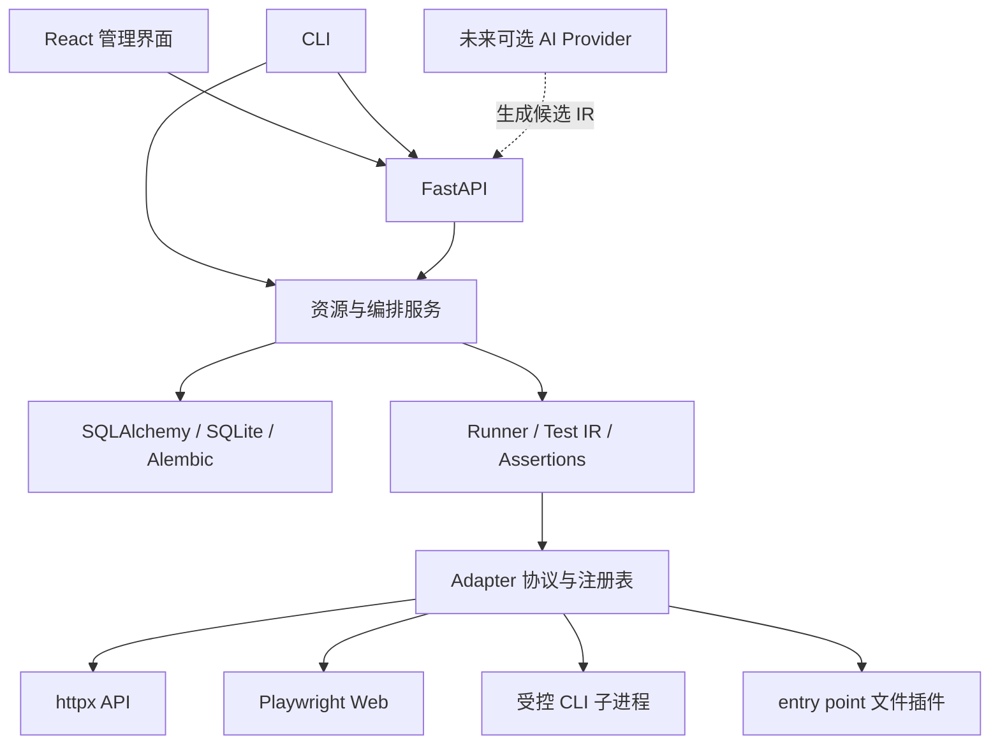

# 架构与执行边界

## 模块和依赖



内核、服务和 API 不导入 AI。适配器不导入资源服务或 API。Test IR 不引用 HTTP、DOM、进程等具体技术对象；操作配置由适配器解释。测试对象由 Target.kind 表示，功能／回归等测试类型由 tags 和 metadata 表示，两者独立。

目录：

```text
backend/omnitest/
  core/             IR、断言、运行器、执行范围和脱敏
  adapters/         协议、注册表及实际实现
  services/         资源引用完整性、编排、持久化调度、工作目录锁
  api/              管理 API、报告下载、SPA 托管
  migrations/       打包随行的 Alembic 迁移
  ai/               独立可选协议，Phase 1 不加载
  config.py         管理员配置
  db.py             ORM 模型与数据库初始化
  cli.py            本地和 API 两种使用方式
  demo.py           可复现的用例定义
  demo_app.py       独立被测示例应用
backend/tests/      自动化测试
frontend/src/       React 管理应用
examples/           CLI fixture 与文件 fixture
scripts/            可重复验收入口
docs/               产品和开发文档
```

## 存储设计

`resources` 保存版本化 JSON 配置，并对 kind、project_id 建索引；Pydantic Schema 限定各资源格式，资源服务在单个事务内检查引用和项目归属。共享资源表避免为不断扩展的领域引入大量空表。`runs` 和 `case_results` 是独立的执行表，运行表关联结果使用外键。

提交任务时复制用例、目标、环境和参数形成不可变快照；后续编辑用例不影响已提交任务。敏感环境值须使用引用，快照不解析密钥。表结构升级使用 Alembic，IR 的兼容性使用 schema_version。SQLite 启用 WAL、外键与 30 秒 busy timeout，数据库操作为短事务；网络和浏览器操作不会持有数据库事务。

## 执行模型

本机队列由单进程 asyncio 执行器每 250ms 检查任务和定时配置。最多同时接纳 8 个运行，各运行遵循自身并发，全部实际用例还受全局 semaphore（4）限制。concurrency=1 即按定义顺序执行；参数矩阵按数据集顺序展开。

状态：PENDING → RUNNING → PASSED／FAILED／ERROR／SKIPPED／CANCELLED。明确断言不满足是 FAILED；超时、配置拒绝、依赖缺失、网络或适配器故障是 ERROR。前置条件不满足为 SKIPPED。用例每次重试都保留日志、步骤输出、断言与证据，重试范围为 FAILED／ERROR；取消不重试。

运行汇总优先级为 CANCELLED、ERROR、FAILED；所有用例跳过则为 SKIPPED，其余没有失败为 PASSED。通过率分母包含所有结果，包括跳过和取消。耗时是墙钟时间；各结果单独记录耗时。未得到终态的结果会转成 ERROR，不能被默认为通过。

服务优雅停止时取消活动任务并清理适配器。服务崩溃后：RUNNING 标记 ERROR，并保留已完成结果；PENDING 正常恢复。中断任务不自动重放，避免重复写操作。数据库目录锁保证同一目录只有一个执行服务；本地 CLI 在服务运行时需用 `--url`。

调度保存 interval_seconds 和 UTC epoch next_run。服务重启后到期配置合并触发一次，下一次设为当前时间加间隔，不追赶全部错过的时间点。任务持续时间可能超过间隔，因此可能产生排队；此版本没有按套件禁止重叠的策略。禁用调度不取消已提交任务。日期在前端按浏览器本地时区展示。

## 适度安全隔离

平台是可信操作者的本地工具，API Token 为单管理员权限，不是多租户隔离方案。默认绑定 127.0.0.1；非本地绑定必须开启认证。跨 Origin 请求拒绝，前端开发通过同源代理访问。远程部署还应在 HTTPS 和认证反向代理之后。

- 网络目标须明确授权；管理员决定远程主机白名单，默认只认可 loopback IP 和 localhost，避免默认接受可变 DNS 名称。每次 HTTP 请求检查 origin，不自动跟随 redirect。Web 对资源请求执行同源策略、阻止下载和 service worker，禁用 WebSocket。
- HTTP Body、进程输出、可读文件和步骤数有限额；用例和重试次数有上限。没有 OS 级 CPU／内存配额，也没有对恶意网页的完整网络沙箱。
- CLI 使用 create_subprocess_exec，无 shell；可执行程序和前缀参数仅来自管理员配置，每个参数逐项 fullmatch。工作目录固定到本次运行的证据目录；用户不能选择 executable 或 cwd。Unix 结束时终止进程组，即使直接父进程已经退出；Windows 在父进程仍存活时通过 taskkill /T /F 清理进程树，再回收管道。Windows 已退出父进程留下的脱离子进程不保证可追踪；这不是 OS 沙箱，仍只支持可信程序。
- 文件插件限定管理员 file_root，resolve 后检查相对路径；证据只能通过结果 manifest 中的相对路径下载，禁用任意目录浏览。
- 日志、报告和文本证据对已配置 `OMNITEST_SECRET_*` 的值脱敏，并遮蔽常见敏感字段及 Bearer token；截图遮蔽密码输入、被秘密值填充的输入和目标 mask_selectors。未知业务敏感字段应通过 mask_selectors 配置，截图不保证自动识别页面所有隐私文本。
- HTTP 写操作单独要求 allow_mutations；CLI profile 注册即属于管理员对该可信程序的执行授权。压力／安全／破坏性操作不在 Phase 1 支持范围，不能通过任意 shell 或 AI 输出绕过执行白名单。

管理员 CLI profile 示例：

```json
{
  "allowed_hosts": ["staging.example.com"],
  "file_root": "/srv/fixtures",
  "cli_programs": {
    "version-check": {
      "argv": ["/usr/local/bin/my-safe-tool", "inspect"],
      "arguments": ["version|health"],
      "min_args": 1,
      "inherit_env": ["TEST_TOOL_REGION"],
      "env": {"TOOL_MODE": "regression"}
    }
  }
}
```

不要给 Python、Shell 等解释器配置可执行任意代码的自由参数。内置 demo-tool 是解释器加固定项目脚本，脚本自身也有受限命令集。

## 第五阶段工程化补充

管理 API 增加独立 AccessControl：命名凭据、角色和项目范围由服务器配置定义，列表查询及详情、导出、执行、取消、证据访问共同受控。未配置命名凭据的本地单管理员模式兼容原有行为。API 请求审计通过 0002 迁移增加独立表，不修改既有项目、用例和运行数据。

平台令牌 `OMNITEST_ACCESS_*` 不属于 Test IR 的 secret 命名空间。启用任意管理 API 认证时，编排器向 Runner 传入管理员为项目分配的测试凭据名称集合；参数、断言、Appium capabilities 和故障控制 profile 的引用均受该集合约束。HTTP、CLI、调度复用同一规则，核心不导入身份或 AI 模块。原有无认证本机模式保持兼容。

CLI 默认只继承 PATH／PATHEXT、SystemRoot 等系统路径、临时目录、语言与编码、时区和基本处理器环境。HOME／USERPROFILE、代理、云平台凭据、GitHub Token、自定义变量等不会自动传入。管理员通过 `inherit_env` 逐项允许额外非 OMNITEST_* 变量，通过 `env` 显式设置程序环境；普通项目编辑者不能修改这些 profile。工作目录和环境收敛不能替代文件系统或进程权限隔离。

离线备份在 worker lock 下使用 SQLite backup API 并归档默认证据与 fixture。恢复校验通过后才安装到新目录。正式 wheel 包含 SPA、迁移和公开 SDK，在源码外运行时从包内提供界面。运行维护提供实际队列、审计和加载错误，仍只有一个本地调度器；没有伪造分布式节点。

完整配置与边界见 [Phase 5](phase5.md)。

## 远程执行节点

v0.3.0 为 Orchestrator 增加独立 NodeService，使用 node_states / node_leases 持久化节点状态和运行租约。管理端提交时校验项目和适配器范围，固定选择本机或节点，任务快照记录 node_id；本机 poll 不领取远程任务。worker 通过独立节点凭据调用 /api/worker 领取、续约、上传证据和提交单用例结果。复用相同 Runner / Adapter 协议，不将 HTTP、浏览器或设备逻辑放进协调器。

当前单进程协调服务持有 SQLite 目录锁，线程锁串行化租约领取与取消／完成；不共享 SQLite 至执行节点。租约失效或服务重启结束已领取任务且不重放，旧结果由 claim_id 与终态检查拒绝。远程测试凭据取协调服务与节点 project_secrets 交集。完整运行步骤、传输额度及限制见 [远程执行](remote-execution.md)。

## MQTT 与日历调度

MQTTAdapter 通过 entry point 注册，使用 Paho 网络线程与 asyncio 任务通信；SUBACK / PUBACK 以 Future 桥接，入站消息通过有界队列传递，结束时断开并等待线程退出。ExecutionContext 增加可选 allowed_secrets 供连接阶段读取项目授权的凭据引用，不改变旧适配器调用方式。发布／订阅另受目标 topic_prefix 和写入授权约束。

Schedule 的 JSON 字段兼容旧 interval_seconds 配置，新增 Cron、IANA 时区、重叠与补跑策略。calendar 模块只使用 APScheduler CronTrigger 计算时间，不启动第二个调度器。原有短事务中同时更新下次时间、跳过状态或新运行，重复触发检查以持久化 source 关联已有 PENDING / RUNNING 任务。预览不创建运行，夏令时行为与实现边界见 [MQTT 与日历调度](mqtt-scheduling.md)。

## 数据计划与成员授权

Dataset 使用既有 resources 表保存经验证的行，TestIR 的 dataset_ids 由资源服务检查同项目引用。Environment.target_overrides 只能映射同项目、同类型目标。Orchestrator 在提交事务中展开行、解析实际目标并复制来源至快照；本机与 worker 注入相同 selection 元数据，节点回传时由协调服务确认该来源。导入原文件不作为可执行代码或服务器路径使用。

迁移 0004 增加 members、teams 和 team_members，成员令牌只存高熵凭据的 SHA-256 摘要。AccessControl 每个请求读取启用成员及团队，按项目合并角色，在解析实际资源项目之后检查写入／执行权限。界面 settings 查询附带当前 project_id 取得对应按钮权限，身份切换仍清理先前会话数据。启动时拒绝含账户的数据库降级为无认证本地模式，保留管理员文件凭据作为引导入口。
